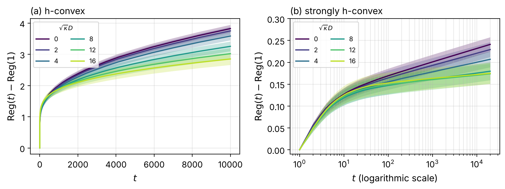
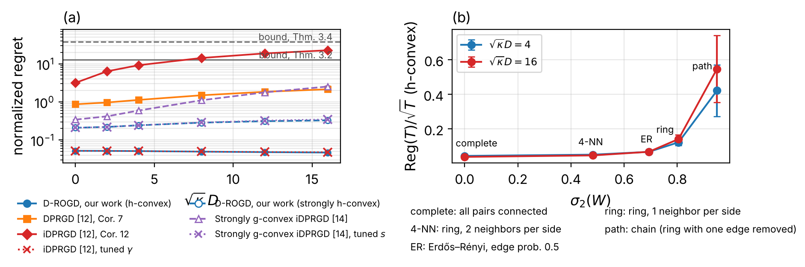

# Curvature-Independent Regret Bounds for Distributed Online Optimization on Hadamard Manifolds

Code and data for the numerical experiments of

> Zhanyuan Cai, Emre Sahinoglu, and Shahin Shahrampour, "Curvature-Independent Regret Bounds for Distributed
> Online Optimization on Hadamard Manifolds." Submitted to *IEEE Control Systems Letters*; preprint
> [arXiv:2609.13646](https://arxiv.org/abs/2609.13646).

The paper studies **D-ROGD** (Distributed Riemannian Online Gradient Descent), which combines local Riemannian
h-subgradient steps with an implicit weighted Fréchet-mean consensus. For h-convex and strongly h-convex local
losses it attains O(√T) and O(log T) static regret, with step sizes and bounds that contain no curvature factor.
The experiments test this on hyperbolic spaces of controlled curvature (Figs. 1 and 2) and on the control
application described at the end of Section IV: decentralized online estimation of a sensor-noise covariance on
the manifold of symmetric positive-definite matrices.

## Contents

| Path | Content |
|---|---|
| `fig1_fig2_hyperbolic_curvature.ipynb` | D-ROGD and the baselines on the hyperbolic space ℍ¹⁰ of curvature −κ, √κ D ∈ {0, 2, 4, 8, 12, 16}: **Figs. 1 and 2** of the paper and the numbers quoted in the text |
| `control_application_sensor_network.ipynb` | Control application of Section IV: decentralized online covariance estimation on SPD(5) with two faulty sensors (figure shown in our response to the reviewers) |
| `results/hyperbolic/`, `results/sensor_network/` | Saved results of every run (one `.npz` file per task and seed), the configuration (`config.json`) and the tuned baseline parameters (`tuned.json`) |
| `figures/` | Figures and numerical summaries written by the notebooks |

Each notebook is self-contained: it holds the whole implementation (manifolds, graphs, consensus solvers,
simulation loop, data generation), sanity checks, the runs, and the figures. There are no other source files.

## Requirements

Python 3.10 or later with numpy, scipy, matplotlib and Jupyter (`pip install -r requirements.txt`); no GPU. The
experiments were run on a 4-core Kaggle CPU session with numpy 2.1.3; the figures and summaries in `figures/` were
regenerated from the saved results with numpy 2.5, scipy 1.18 and matplotlib 3.11.

## Reproducing the figures

**From the saved results (minutes).** Open a notebook and run all cells. Every run writes its own file under
`results/` and is skipped if that file already exists, so with the results in this repository the notebooks only
redraw the figures and recompute the summaries (about two minutes for the curvature study, a few seconds for the
control application). Section 5 of each notebook needs only numpy, scipy, matplotlib and the `results/` folder, so
the figures can also be redrawn by running that section alone.

**From scratch.** Delete or rename `results/hyperbolic/` (or `results/sensor_network/`) and run all cells. The
curvature study takes about 5.5 hours on 4 CPU cores and the control application about 15 minutes; an interrupted
run resumes where it stopped. With an empty results folder, `QUICK_RUN = True` (first code cell) gives a smoke test
with 3 seeds and short horizons.

| Figure | Notebook, section | Output |
|---|---|---|
| Fig. 1 | `fig1_fig2_hyperbolic_curvature.ipynb`, Section 5.3 | `figures/fig1_regret.pdf` |
| Fig. 2 | `fig1_fig2_hyperbolic_curvature.ipynb`, Section 5.4 | `figures/fig2_baselines_topology.pdf` |
| Control application (Fig. R1 of the response to the reviewers) | `control_application_sensor_network.ipynb`, Section 5.2 | `figures/fig_control_application.pdf` |
| Numbers quoted in the paper and in the response | Section 6 of the first notebook; Section 5.3 of the second | `figures/summary_hyperbolic.txt`, `figures/growth_fits_hyperbolic.txt`, `figures/controls_hyperbolic.csv`, `figures/summary_sensor_network.txt` |




## Experimental setup

**Curvature study (Figs. 1 and 2).** Hyperbolic space ℍ¹⁰ of curvature −κ with κ ∈ {0, 0.25, 1, 4, 9, 16}
(κ = 0: Euclidean reference). Every constant of the regret bounds is held fixed while only the curvature changes:
the feasible set is the geodesic ball of radius 2 (D = 4); the local losses are d(·, S) (geometric median, L = 1)
and ½ d²(·, S) (Fréchet mean, μ = 1, L = D); 8 agents on a ring with 2 neighbours per side and Metropolis weights;
data centres at fixed positions on one geodesic and observations S = Exp_a(ξ) around each data centre a, with a
uniformly distributed tangent direction and ‖ξ‖ ~ U[0, 0.8]. The same random numbers are used for every curvature
and every method. All agents start at a common point on the boundary of the feasible set. Horizons: T = 10⁴
(h-convex) and T = 2·10⁴ (strongly h-convex); 30 seeds.

**Control application (Section IV).** Ten sensors on a random geometric graph estimate a measurement-noise
covariance on SPD(5) with the affine-invariant metric. Each round, every sensor forms the sample covariance of 20
Gaussian measurements; two faulty sensors report it multiplied by 4. T = 2000, 30 seeds.

**Methods.** D-ROGD with η_t = 1/√t (h-convex) and η_t = 1/(μt) (strongly h-convex); DPRGD and iDPRGD of Chen and
Sun [12] with the curvature-dependent parameters prescribed by their analysis ([12, Cor. 7] and
[12, Lemma 8, Cor. 12]); the method of [14] for strongly convex losses with its prescribed consensus step; and
iDPRGD and [14] with D-ROGD's step sizes and a consensus step tuned on three held-out seeds. Reference numbers
follow the paper:

* [12] H. Chen and Q. Sun, "Decentralized online Riemannian optimization with dynamic environments,"
  arXiv:2410.05128, 2024.
* [14] Z. Cai, E. Sahinoglu, and S. Shahrampour, "Decentralized online Riemannian optimization for strongly
  geodesically convex functions," arXiv:2607.20316, 2026.

**Implementation notes.**
* Hyperbolic space is implemented in the Lorentz model, which stays accurate in float64 at large curvature.
* The weighted Fréchet mean of the consensus step is computed by Riemannian gradient descent with Armijo
  backtracking (unit first step, i.e., Karcher iteration) and stops when the gradient norm is at most 10⁻⁹.
  Since the consensus objective is 1-strongly geodesically convex, this guarantees a distance of at most 10⁻⁹
  to the exact mean, i.e., ε_t ≤ 10⁻⁹ in Proposition 3.6.
* The regret at horizon t uses the comparator of that horizon, computed to tolerance 10⁻¹⁰.

## Result files

The curvature appears in the file names as `k` followed by κ (`k0`, `k0.25`, `k1`, `k4`, `k9`, `k16`), the
seed as `s` followed by its number.

| Files | Content |
|---|---|
| `results/hyperbolic/main_k*_s*.npz` | all methods: regret at log-spaced checkpoints, consensus cost, disagreement, control quantities |
| `results/hyperbolic/growth_k*_s*.npz` | D-ROGD on dense checkpoints (Fig. 1 and growth-rate fits) |
| `results/hyperbolic/early_rounds.npz` | D-ROGD, rounds 1-10 (Fig. 1 starts at t = 1; written by Section 4.6) |
| `results/hyperbolic/topo_k*_s*.npz` | five communication networks (Fig. 2(b)) |
| `results/hyperbolic/tol_k*_s*.npz` | consensus tolerances and one-step consensus (Proposition 3.6) |
| `results/hyperbolic/tune_k*_s*.npz`, `results/sensor_network/tune_s*.npz` | tuning runs of the baselines on seeds 900-902 |
| `results/sensor_network/main_s*.npz` | all methods of the control application |

## Previous version

The code that accompanied the originally submitted manuscript (experiments on a concept hierarchy embedded in the
Poincaré ball) is available under the tag
[`v1.0-submission`](https://github.com/ZhanyCai-opt/decentralized-online-riemannian-curvature-independent/tree/v1.0-submission).

## Citation

```bibtex
@misc{cai2026curvature,
  title         = {Curvature-Independent Regret Bounds for Distributed Online Optimization on Hadamard Manifolds},
  author        = {Cai, Zhanyuan and Sahinoglu, Emre and Shahrampour, Shahin},
  year          = {2026},
  eprint        = {2609.13646},
  archivePrefix = {arXiv},
  note          = {Submitted to IEEE Control Systems Letters}
}
```

## License

MIT License; see `LICENSE`.
